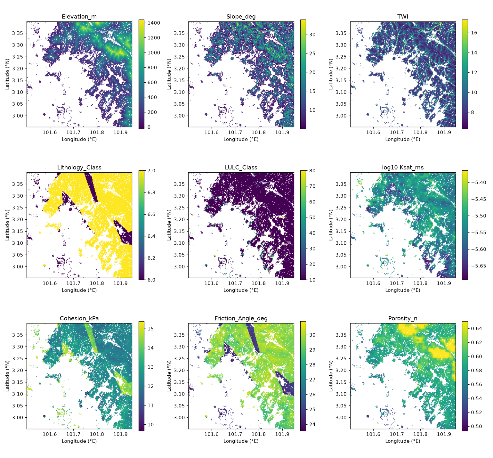
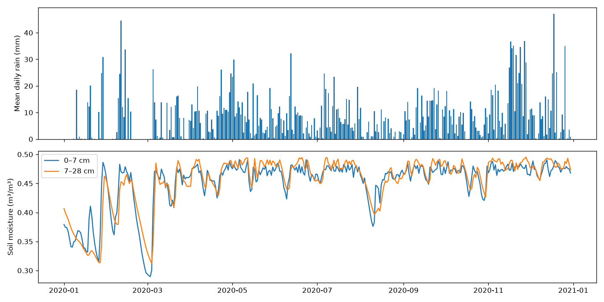
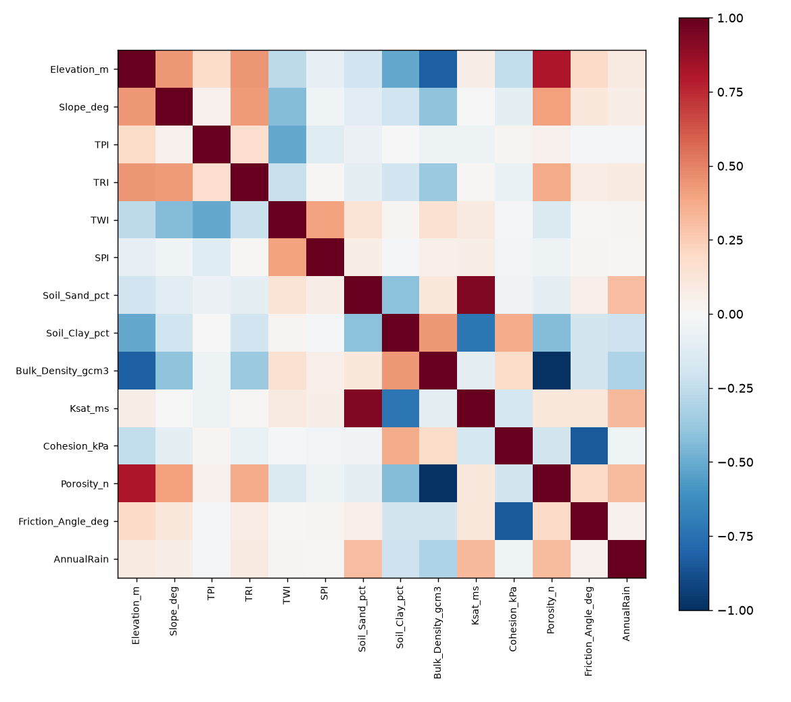
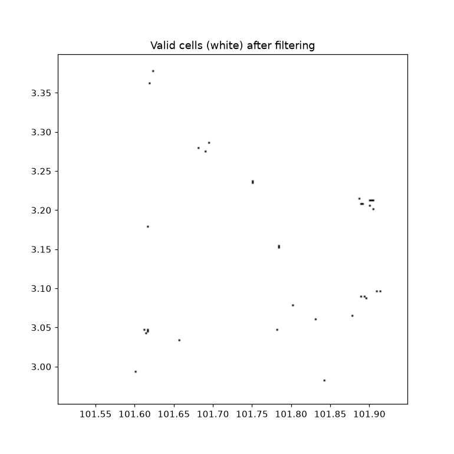

# EDA & filtering report

Cells: **17,003**, days: **365** (2020-01-01 – 2020-12-30), cell-days: 6,206,095

## Missing values

| variable | missing | % |
|---|---|---|
| rain (daily) | 0 | 0.00 |
| Rain_24h_mm (daily) | 0 | 0.00 |
| AntRain_3d_mm (daily) | 17,003 | 0.27 |
| AntRain_7d_mm (daily) | 17,003 | 0.27 |
| AntRain_30d_mm (daily) | 17,003 | 0.27 |
| SoilMoist_0_7cm (daily) | 0 | 0.00 |
| SoilMoist_7_28cm (daily) | 0 | 0.00 |
| AntRain_3d recomputed from Rain_24h | median |Δ| vs GEE = 6.91 mm | |
| AntRain_7d recomputed from Rain_24h | median |Δ| vs GEE = 9.52 mm | |
| AntRain_30d recomputed from Rain_24h | median |Δ| vs GEE = 22.51 mm | |

## Static variables

|                    |   count |      mean |        std |      min |      25% |      50% |      75% |         max |
|:-------------------|--------:|----------:|-----------:|---------:|---------:|---------:|---------:|------------:|
| Latitude           |   17003 |    3.2318 |     0.1194 |   2.9521 |   3.1475 |   3.2598 |   3.3294 |      3.399  |
| Longitude          |   17003 |  101.805  |     0.1069 | 101.502  | 101.731  | 101.825  | 101.895  |    101.949  |
| Elevation_m        |   17003 |  436.343  |   282.866  | -25      | 207      | 371      | 615.5    |   1442      |
| Slope_deg          |   17003 |   12.4792 |     5.2174 |   5.0002 |   8.1598 |  11.7482 |  15.9546 |     33.939  |
| Aspect_deg         |   17003 |  190.486  |    97.7331 |  -0      | 110.774  | 202.142  | 270      |    359.803  |
| Eastness           |   17003 |   -0.1074 |     0.7215 |  -1      |  -0.8345 |  -0.2219 |   0.6138 |      1      |
| Northness          |   17003 |   -0.0747 |     0.68   |  -1      |  -0.7313 |  -0.1349 |   0.5541 |      1      |
| Horiz_Curvature    |   17003 |   -0.0016 |     0.0524 |  -0.2722 |  -0.0322 |   0.0011 |   0.0311 |      0.2233 |
| Vert_Curvature     |   17003 |   -0.0012 |     0.0471 |  -0.3067 |  -0.0278 |   0.0011 |   0.0278 |      0.2511 |
| TPI                |   17003 |    0.8752 |    21.0774 | -98.2222 | -13.7778 |  -0.7778 |  14      |    114.778  |
| TRI                |   17003 |   17.0275 |     6.4485 |   2.7654 |  12.2099 |  16.358  |  21.037  |     50.0123 |
| TWI                |   17003 |    9.1555 |     1.6123 |   6.3252 |   7.9859 |   8.7012 |   9.9632 |     17.3012 |
| SPI                |   17003 | 2100.44   | 13119.2    |  26.6139 | 135.66   | 309.17   | 849.723  | 711488      |
| Soil_Sand_pct      |   17003 |   35.6679 |     2.4539 |  26.0501 |  34.1389 |  35.6877 |  37.228  |     46.6258 |
| Soil_Silt_pct      |   17003 |   27.2836 |     2.7758 |  16.9451 |  25.2032 |  27.0886 |  29.3877 |     36.7869 |
| Soil_Clay_pct      |   17003 |   37.0485 |     2.6407 |  28.968  |  35.1873 |  36.9842 |  38.8364 |     47.4346 |
| Bulk_Density_gcm3  |   17003 |    1.0644 |     0.0716 |   0.8    |   1.0408 |   1.0762 |   1.1034 |      1.3416 |
| LULC_Class         |   17003 |   11.4774 |     7.7981 |  10      |  10      |  10      |  10      |     80      |
| Lithology_Class    |   17003 |    6.8744 |     0.3314 |   6      |   7      |   7      |   7      |      7      |
| Ksat_ms            |   17003 |    0      |     0      |   0      |   0      |   0      |   0      |      0      |
| Cohesion_kPa       |   17003 |   12.6208 |     0.7857 |   9.68   |  12.23   |  12.47   |  12.77   |     15.37   |
| Porosity_n         |   17003 |    0.5974 |     0.0246 |   0.4937 |   0.5836 |   0.5939 |   0.6072 |      0.65   |
| Friction_Angle_deg |   17003 |   28.9747 |     1.6649 |  23.57   |  29.19   |  29.56   |  29.81   |     30.9    |

## Rainfall 2020

- Annual total per cell: mean 2811 mm, min 2295, max 3205
- Max daily rain anywhere: 69.1 mm; negative values: 0
- Unique rain values per day (spatial resolution check): median 16252

## Consistency checks

| check | count |
|---|---|
| Slope outside 0–90° | 0 |
| Sand+Silt+Clay not within 95–105 % | 0 |
| Bulk density outside 0.8–2.1 g/cm³ | 1 |
| Soil moisture > porosity (cell-days) | 0 |
| Soil moisture outside 0–1 (cell-days) | 0 |
| Ksat outside 1e-8–1e-3 m/s | 0 |
| Duplicate coordinates | 0 |
| Constant columns | none |

## Categorical layers

| LULC | cells |
|---|---|
| 10 Tree cover | 16,355 |
| 50 Built-up | 367 |
| 30 Grassland | 143 |
| 60 Bare/sparse | 104 |
| 80 Water | 34 |

| Lithology | cells |
|---|---|
| pa | 14,867 |
| mt | 2,136 |

## Highly correlated pairs (|r| > 0.8)

- Elevation_m ~ Bulk_Density_gcm3: r = -0.82
- Elevation_m ~ Porosity_n: r = 0.80
- Soil_Sand_pct ~ Ksat_ms: r = 0.93
- Bulk_Density_gcm3 ~ Porosity_n: r = -0.99
- Cohesion_kPa ~ Friction_Angle_deg: r = -0.84

## Filters applied

| filter | cells removed (alone) |
|---|---|
| slope < 5.0° | 0 |
| water (LULC) | 34 |
| water/no-data lithology | 0 |
| missing geotech params | 0 |
| invalid soil texture | 0 |
| no rainfall data | 0 |

**Valid cells kept: 16,969 / 17,003** (99.8 %). Urban cells kept but flagged: 367. First 30 days are an antecedent-rain burn-in period.

## Figures

